 

# Timofey · trima03

**Backend development · Machine learning · DevOps**

DevOps and IT systems engineering student at Far Eastern Federal University.

 

---

## 👋 About me

I build backends for Telegram bots and explore how machine learning becomes a working service. I study DevOps and IT systems engineering at FEFU and practice algorithms in C++.

My interests meet where **code, data and infrastructure** come together: from an asynchronous Python application to a model served through an API.

## ⚡ What I work on

| Area | Focus |
| :--- | :--- |
| **Backend** | Python services, Telegram bots, asynchronous programming and APIs |
| **Machine learning** | Data processing, forecasting and model evaluation |
| **DevOps** | Containerization, service deployment and monitoring |
| **Algorithms** | Problem solving and data structures in C++ |

## 🛠 Tech stack

| | Technologies |
| :--- | :--- |
| **Languages** | Python, C++, SQL |
| **Backend & bots** | FastAPI, aiogram, Pyrogram, asyncio |
| **Data & ML** | Pandas, scikit-learn |
| **Databases** | SQLite, aiosqlite |
| **Deployment & monitoring** | Docker, Kubernetes, Prometheus, Grafana, GitHub Actions |

## 🚀 Selected projects

### [01 / Demand Forecasting](https://github.com/trima03/demand-forecasting-ml)

A retail demand forecasting pipeline with a FastAPI inference service. Compares a gradient boosting model against a seasonal baseline using time-aware validation.

`Python` · `scikit-learn` · `FastAPI` · `Prometheus`

### [02 / ML Service Delivery](https://github.com/trima03/ml-service-delivery)

Deployment and observability for the forecasting service: Docker Compose, Kubernetes manifests, health checks, metrics and a Grafana dashboard.

`Docker` · `Kubernetes` · `Prometheus` · `Grafana`

### [03 / Auto Gift](https://github.com/trima03/auto_gift)

An asynchronous Telegram client with modular event monitoring, notifications, logging and graceful shutdown.

`Python` · `Pyrogram` · `asyncio`

## 📚 Currently exploring

- Connecting ML models to backend services.
- Deployment workflows and service observability.
- LLM applications and AI agents.
- Algorithms and data structures in C++.

<b>More about my learning path</b>

 

- **University:** Far Eastern Federal University — DevOps and IT systems engineering.
- **Practice:** backend development, Telegram automation and ML projects.
- **Events:** participant in the Quantum Marathon and selection rounds for School 21 and Fintech Academy.

## 📫 Let's connect

You can reach me on [Telegram — @ttddkkk](https://t.me/ttddkkk) to discuss backend development, ML or a project idea.

---

Learning by building. Improving with every iteration.

